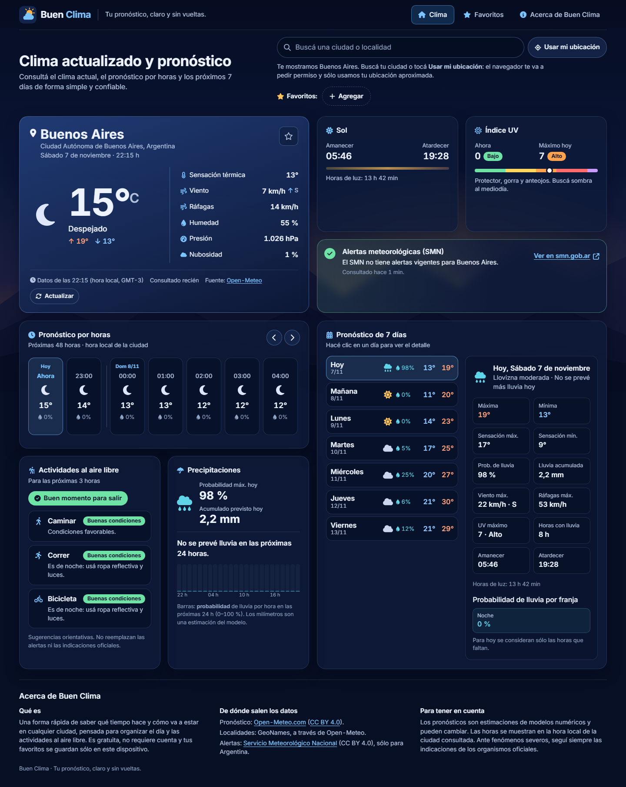
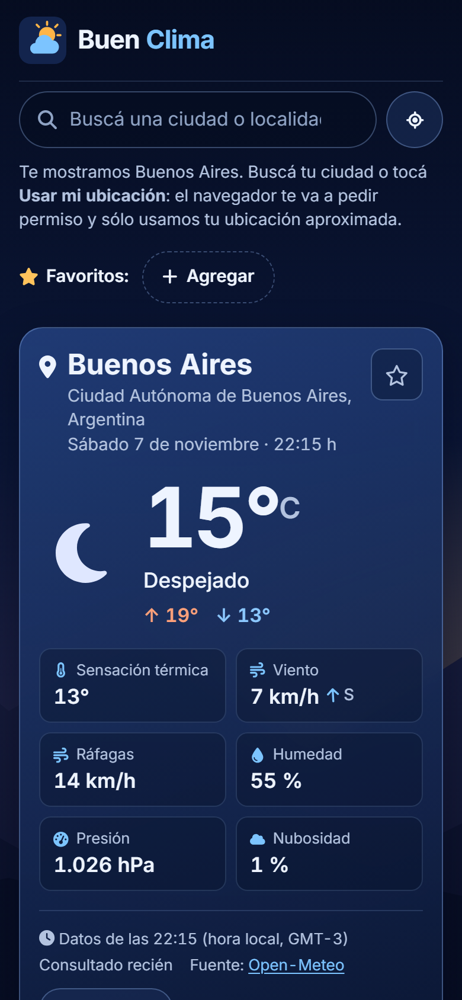

# Buen Clima

**Tu pronóstico, claro y sin vueltas.**

Buen Clima es una aplicación meteorológica en español de Argentina para consultar el tiempo de cualquier ciudad del mundo y organizar actividades cotidianas y al aire libre: temperatura y sensación térmica, pronóstico por hora y de 7 días, lluvia (probabilidad y milímetros por separado), índice UV, amanecer y atardecer, alertas oficiales del SMN y recomendaciones para caminar, correr o andar en bicicleta.

| Escritorio | Mobile |
| --- | --- |
|  |  |

> Capturas tomadas de la aplicación real en ejecución local (`frontend/scripts/capture.mjs`), con datos de Open-Meteo.

---

## Qué problema resuelve

Muchas apps de clima mezclan datos, muestran horarios en la zona del dispositivo o presentan como "lluvia" un porcentaje sin aclarar cuánto va a llover. Buen Clima prioriza:

- **Datos correctos y trazables**: un solo proveedor meteorológico, unidades explícitas, fuente y antigüedad visibles.
- **Horarios de la ciudad consultada**: todas las horas usan la zona IANA de la localidad (con horario de verano), no la del navegador ni la del servidor.
- **Alertas oficiales sin inventos**: sólo se informa "sin alertas vigentes" después de consultar con éxito al SMN.
- **Experiencia mobile real**: una columna con scroll vertical natural, el clima actual en la primera pantalla y controles táctiles de 44 px.

## Funcionalidades

- Búsqueda predictiva de localidades (debounce, cancelación de peticiones, descarte de respuestas viejas, navegación por teclado, homónimos diferenciados por provincia/partido/país).
- **Mi ubicación** con permiso explícito del navegador; maneja permiso denegado, timeout, contexto no seguro y dispositivos sin geolocalización.
- **Favoritos** en `localStorage` (sin cuentas), sin duplicados, tolerantes a datos corruptos o almacenamiento bloqueado. Recuerda la última localidad.
- Clima actual: temperatura, sensación térmica, condición (día/noche), viento con dirección y ráfagas, humedad, presión, nubosidad.
- **48 horas** en carrusel táctil con temperatura, ícono, probabilidad de lluvia y milímetros previstos; separadores de día.
- **7 días** con mín/máx reales del proveedor; detalle expandible (acordeón en mobile, panel lateral en escritorio) con sensación térmica, lluvia por franja, viento, UV, amanecer/atardecer y horas de luz.
- **Precipitaciones**: frases naturales sólo cuando los datos las respaldan ("Se prevé lluvia desde las 15:00"), intensidad estimada y gráfico de probabilidad por hora.
- **UV** actual vs. máximo previsto, con escala de la OMS y consejos.
- **Alertas oficiales del SMN** (Argentina) filtradas por la ubicación consultada; enlace a smn.gob.ar ante errores o fuera de cobertura.
- **¿Salimos?**: recomendaciones explicables para caminar, correr y bicicleta según sensación térmica, viento, lluvia, tormentas y UV.
- Estado de los datos: fuente, hora de referencia meteorológica (con su zona, por ejemplo GMT-3), última consulta, aviso de datos desactualizados y botón **Actualizar**. Se actualiza solo al volver a la pestaña o al recuperar la conexión.
- **Uso sin conexión**: un service worker guarda la app y el último pronóstico de las 6 localidades más recientes; sin Internet se muestran con su antigüedad y un aviso claro.
- Sección **Acerca de Buen Clima** con qué es la app, de dónde salen los datos y sus limitaciones.
- Estados de interfaz: primera visita, esqueleto de carga, servidor iniciándose (cold start), sin resultados, errores de red/API con reintento, datos anteriores disponibles, datos parciales. Sin modales bloqueantes.
- Accesibilidad: HTML semántico, combobox ARIA, foco visible, enlace "saltar al contenido", regiones `aria-live`, `prefers-reduced-motion` y `prefers-reduced-transparency`.

## Tecnologías

| Capa | Stack |
| --- | --- |
| Frontend | React 18, Vite 7, CSS Modules, Font Awesome 6 (íconos individuales) |
| Backend | Node.js ≥ 22.12, Express 4, Helmet, CORS, express-rate-limit, compression |
| Tests | `node:test` (backend), Vitest 4 + Testing Library (frontend), Playwright (E2E) |
| CI | GitHub Actions: lint, tests, build, auditoría de dependencias y E2E |

## Arquitectura

```
Navegador ──► Open-Meteo Geocoding (búsqueda de localidades, directo y sin key)
    │
    └──► Backend Express (/api)
            ├── GET /api/weather?lat&lon ──► Open-Meteo Forecast (1 sola llamada agrupada)
            └── GET /api/alerts?lat&lon  ──► SMN feed CAP (alertas oficiales, Argentina)
```

```
backend/src
├── config/env.mjs           Validación de variables de entorno
├── errors.mjs               Errores de dominio con códigos estables
├── lib/httpClient.mjs       GET HTTPS con timeout y reintentos sólo transitorios
├── lib/ttlCache.mjs         Caché TTL + LRU + dedupe concurrente + stale-if-error
├── providers/               Clientes externos (Open-Meteo, SMN)
├── adapters/                Normalización (Open-Meteo → contrato interno, parser CAP)
├── domain/weatherCodes.mjs  Códigos WMO → descripción en español + ícono día/noche
├── services/                Casos de uso (clima, alertas)
├── controllers/ routes/     Capa HTTP
└── middleware/              Errores y logs sin datos sensibles

frontend/src
├── components/{layout,search,favorites,weather,ui}
├── hooks/        useWeather, useAlerts, useFavorites, useGeolocation, useLocationSearch
├── services/     Clientes HTTP (backend, geocoding) con reintentos para cold start
├── domain/       Reglas puras: UV, viento, lluvia, actividades, localidades
└── lib/          Formateadores con zona horaria y almacenamiento seguro
```

### Contrato de `/api/weather`

```jsonc
{
  "location": { "latitude": -34.62, "longitude": -58.41, "timezone": "America/Argentina/Buenos_Aires" },
  "units": { "temperature": "°C", "windSpeed": "km/h", "precipitation": "mm", "pressure": "hPa" },
  "current": { "time": "2026-11-07T04:30:00.000Z", "temperature": 15.5, "apparentTemperature": 14.1,
               "windSpeed": 13.8, "windGusts": 32.8, "condition": { "description": "Parcialmente nublado", "icon": "partly-cloudy-night" } },
  "hourly": [{ "time": "…", "localDate": "2026-11-07", "localHour": 1, "precipitationProbability": 10, "precipitation": 0 }],
  "daily":  [{ "date": "2026-11-07", "temperatureMin": 12, "temperatureMax": 18.9, "precipitationSum": 0.1, "uvIndexMax": 8.4, "sunrise": "…" }],
  "meta": { "source": { "name": "Open-Meteo" }, "fetchedAt": "…", "stale": false }
}
```

Los datos faltantes son `null` (nunca `0`, que es una medición válida). Errores: `{ "error": { "code": "UPSTREAM_UNAVAILABLE", "message": "…" } }` con códigos `INVALID_REQUEST` (400), `RATE_LIMITED` (429), `UPSTREAM_UNAVAILABLE` / `UPSTREAM_INVALID_DATA` (502), `UPSTREAM_TIMEOUT` (504).

## Requisitos

- Node.js 22.12 o superior (lo exige Vite 7). El CI prueba con Node 22 y 26.
- npm 10+.

## Instalación local

```bash
# Backend
cd backend
cp .env.example .env
npm install
npm run dev          # http://localhost:5000

# Frontend (otra terminal)
cd frontend
cp .env.example .env.local
npm install
npm run dev          # http://localhost:5173 — Vite reenvía /api al backend
```

No se necesitan API keys.

## Variables de entorno

**Backend (`backend/.env`)**

| Variable | Obligatoria | Por defecto | Descripción |
| --- | --- | --- | --- |
| `PORT` | no | `5000` | Puerto HTTP (Render lo define solo). |
| `NODE_ENV` | no | `development` | `production` oculta detalles internos de errores. |
| `ALLOWED_ORIGINS` | **en producción** | `localhost:5173,4173` | Orígenes CORS separados por comas. `ALLOWED_ORIGIN` se acepta como alias obsoleto. |
| `TRUST_PROXY` | no | `1` | Proxies delante del servidor (para que el rate limit vea la IP real). |
| `OPEN_METEO_BASE_URL` / `OPEN_METEO_API_KEY` | no | API pública | Sólo para el plan comercial de Open-Meteo. |
| `UPSTREAM_TIMEOUT_MS` | no | `8000` | Timeout por llamada a proveedores. |
| `WEATHER_CACHE_TTL_SECONDS` | no | `600` | TTL de caché de pronósticos. |
| `ALERTS_CACHE_TTL_SECONDS` | no | `600` | TTL de caché del feed del SMN. |
| `CACHE_STALE_SECONDS` | no | `10800` | Ventana para servir datos vencidos si el proveedor falla. |
| `CACHE_MAX_ENTRIES` | no | `500` | Máximo de entradas en memoria. |
| `RATE_LIMIT_MAX` | no | `300` | Solicitudes por IP cada 15 min en `/api`. |

**Frontend (`frontend/.env.local`)**

| Variable | Descripción |
| --- | --- |
| `VITE_API_URL` | URL pública del backend. Vacía en desarrollo (usa el proxy de Vite). |
| `VITE_SITE_URL` | URL pública del sitio para `canonical` y Open Graph. Si falta, esas etiquetas se omiten. |
| `DEV_API_PROXY_TARGET` | Sólo desarrollo: destino del proxy (`http://localhost:5000`). |

## Comandos

| Dónde | Comando | Qué hace |
| --- | --- | --- |
| backend | `npm run dev` / `npm start` | Servidor con recarga / producción |
| backend | `npm test` | Tests unitarios y de integración HTTP (`node:test`) |
| backend | `npm run lint` | ESLint |
| frontend | `npm run dev` / `npm run build` / `npm run preview` | Desarrollo, build y vista previa |
| frontend | `npm test` | Vitest + Testing Library |
| frontend | `npm run test:e2e` | Playwright (escritorio + Pixel 7) sobre el build |
| frontend | `npm run lint` | ESLint |
| frontend | `node scripts/capture.mjs <url>` | Regenera capturas, `og-image.png` y `apple-touch-icon.png` |

## Testing

- **Backend**: validación de coordenadas, configuración, conversión de unidades, zonas horarias (incluido cambio de horario de verano), mínimas/máximas diarias, nulos vs. ceros, caché (TTL, LRU, dedupe, stale-if-error, no cachear errores), timeouts y reintentos, errores del proveedor (que no se reportan como "ciudad no encontrada"), CORS, Helmet, rate limiting y parser/filtrado de alertas CAP. Usa respuestas reales grabadas como fixtures: no depende de Internet.
- **Frontend**: búsqueda predictiva (debounce, teclado, respuestas viejas), favoritos (persistencia, datos corruptos, cuota llena), pronóstico horario y diario expandible, alertas (nunca afirma "sin alertas" si la consulta falló), datos faltantes, errores con reintento y geolocalización.
- **E2E**: entrada, búsqueda, cambio de ciudad, favoritos, día expandido, error de API y ausencia de scroll horizontal en 320–1440 px. API simulada con `page.route`, y el navegador en otra zona horaria para comprobar los horarios locales.

### Lighthouse (build local)

| Categoría | Mobile |
| --- | --- |
| Accesibilidad | 100 |
| Buenas prácticas | 100 |
| SEO | 100 |
| CLS | 0,001 |

El puntaje de rendimiento medido localmente no es representativo: la PC de desarrollo tiene un índice de CPU de 180 (Lighthouse espera más de 1000) y el bloqueo del hilo principal sale inflado. Conviene medir la versión desplegada con [PageSpeed Insights](https://pagespeed.web.dev/). Mejoras aplicadas a partir de la auditoría: fuente web no bloqueante con respaldo de métricas ajustadas (CLS de 0,15 a 0,001), esqueleto de carga del mismo alto que el contenido y fondo SVG en lugar de imagen.

## Despliegue

- **Backend en Render**: `render.yaml` define el servicio (raíz `backend`, `npm start`, health check `/health`). Configurar `ALLOWED_ORIGINS` con la URL del frontend.
- **Frontend en Vercel**: Root Directory `frontend`, framework Vite, Node.js 26.x en Project Settings (la 20.x está discontinuada en Vercel). Definir `VITE_API_URL` (URL de Render) y `VITE_SITE_URL`. `vercel.json` agrega caché inmutable para `/assets` y cabeceras de seguridad.
- El plan gratuito de Render "duerme" el servidor: el frontend lo despierta con `/health`, reintenta con timeouts largos, avisa "Estamos despertando al servidor" y muestra los últimos datos guardados mientras tanto.

## Decisiones técnicas

- **Open-Meteo como proveedor único** en lugar de OpenWeather + WeatherAPI + IPinfo: sin API keys, una sola consulta agrupada con actual + 48 h + 7 días, unidades explícitas y zona IANA. Se eliminó la mezcla de proveedores (antes la descripción venía de uno y el ícono de otro).
- **Sin geolocalización por IP**: requería una API key extra, enviaba la IP a un tercero y era imprecisa. La primera visita muestra Buenos Aires y explica cómo usar la ubicación del dispositivo.
- **Geocoding directo desde el navegador**: la búsqueda funciona aunque el backend esté iniciándose.
- **Coordenadas redondeadas a 2 decimales (~1 km)** antes de consultar: mejor tasa de caché y menos exposición de la ubicación exacta.
- **Caché en memoria** (sin Redis): suficiente para una instancia gratuita; deduplica consultas simultáneas y sirve datos vencidos marcados como tales si el proveedor cae.
- **Parser CAP propio** (≈150 líneas) en lugar de una dependencia XML: el formato es fijo y sólo se aceptan enlaces HTTPS de `ssl.smn.gob.ar`.
- **Fondo en SVG inline** (≈2 KB) en lugar de una imagen WebP de 187 KB.
- **Sin framework de UI ni librería de gráficos**: CSS Modules y CSS Grid con áreas distintas por breakpoint (no se escala el diseño de escritorio); el detalle diario usa *container queries* para adaptarse al ancho real de su panel.
- **Service worker escrito a mano** (≈70 líneas) en lugar de un plugin PWA: red primero para el HTML, caché inmutable para `/assets` y nunca cachea la API.
- **Descartado a propósito**: modo claro (la identidad visual es nocturna y duplicaría el trabajo de contraste), unidades imperiales (el público principal usa °C y km/h), alertas de otros países (cada servicio tiene su propio feed y licencia) y caché persistente en el servidor (requiere infraestructura paga para un beneficio chico con un solo proveedor gratuito).

## Limitaciones actuales

- Las alertas integradas cubren sólo Argentina (SMN). Para otros países se indica consultar el servicio oficial.
- El feed del SMN se descarga completo (~70 documentos) y se cachea 10 minutos; si el SMN cambia el formato, la tarjeta muestra el enlace oficial en lugar de afirmar que no hay alertas.
- La caché vive en memoria: se pierde con cada reinicio del servidor gratuito.
- Las recomendaciones de actividades son reglas simples y orientativas.
- Sin conexión sólo se ven las localidades consultadas recientemente (hasta 6) y la búsqueda no funciona.
- La ubicación del dispositivo no se puede guardar como favorito (no hay geocodificación inversa: se mostraría sólo como "Mi ubicación").
- No hay modo claro, unidades imperiales ni otros idiomas.

## Fuentes de datos, licencias y atribuciones

- **Pronóstico**: [Open-Meteo.com](https://open-meteo.com/) — datos bajo [CC BY 4.0](https://creativecommons.org/licenses/by/4.0/). La API gratuita es sólo para **uso no comercial** ([términos](https://open-meteo.com/en/terms)); un uso comercial requiere el plan pago (soportado con `OPEN_METEO_BASE_URL` y `OPEN_METEO_API_KEY`).
- **Localidades**: Geocoding API de Open-Meteo, basada en [GeoNames](https://www.geonames.org/) (CC BY 4.0).
- **Alertas**: [Servicio Meteorológico Nacional](https://www.smn.gob.ar/alertas), feed CAP público (CC BY 4.0).
- **Íconos**: [Font Awesome Free](https://fontawesome.com/license/free) (CC BY 4.0 / MIT). **Tipografía**: Inter (SIL OFL).

Los pronósticos son estimaciones de modelos numéricos, no garantías. Ante fenómenos severos, seguí siempre las indicaciones de los organismos oficiales.

---

Desarrollado por Emanuel Vera · [Repositorio](https://github.com/EmanuelMVera/WeatherProject)
